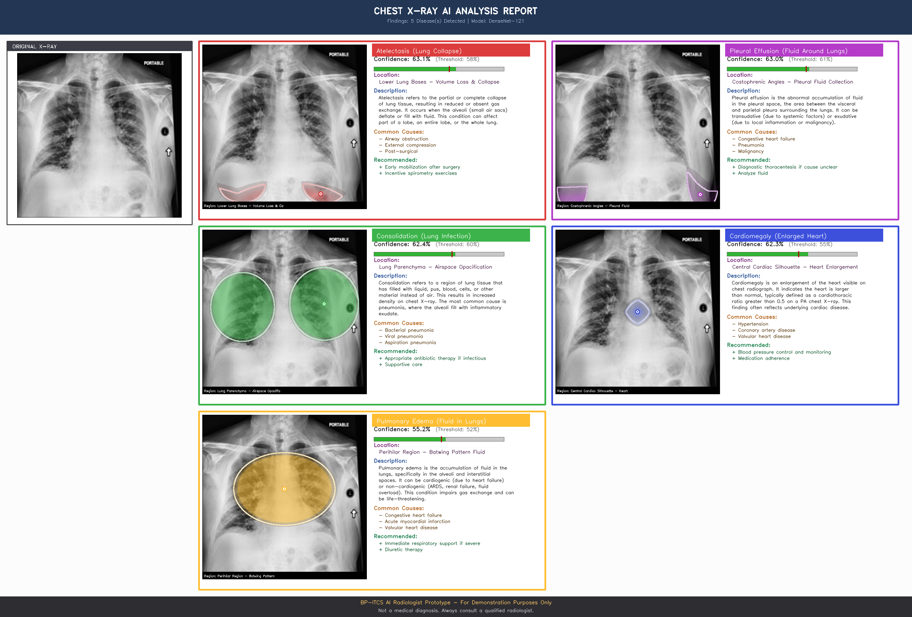

# AI Radiologist — chest X-ray screening with attribution

A screening and explainability demo: it scores a frontal chest radiograph for five thoracic
findings, draws where the evidence sits, and renders a one-page report.

Built to exercise the whole inference path — preprocessing, multi-label scoring, per-finding
decision thresholds, Grad-CAM++ attribution, report rendering — rather than to produce a
better classifier. It runs on public pre-trained weights so it works without the training
artefacts from this repository's other half.



> **Not a medical device.** Research and demonstration code. It must not be used for
> diagnosis, triage, or any clinical decision.

---

## Read this first: which model this runs

This demo does **not** run the model that `../train_phase4_optimized.py` produces.

| | This demo | The fine-tuning job |
| --- | --- | --- |
| Weights | `densenet121-res224-all`, pre-trained and published by [TorchXRayVision](https://github.com/mlmed/torchxrayvision) | DenseNet-121 fine-tuned in this repository from a Phase 3 checkpoint |
| Trained on | ~800k images across NIH ChestX-ray14, CheXpert, MIMIC-CXR, PadChest | CheXpert + NIH ChestX-ray14 + a pneumonia set |
| Findings | 5 screened (of 18 the backbone exposes) | 14 |

They share an architecture, not a checkpoint. Numbers from one do not transfer to the other.

## Pipeline

```
radiograph
   ↓  image_processor.py    resize to 224, normalise to the TorchXRayVision range
   ↓  model_handler.py      DenseNet-121 → 18 pathology scores → 5 screened
   ↓                        per-finding threshold → detected / not detected
   ↓  gradcam.py            Grad-CAM++ (second-order gradients) on the final
   ↓                        batch-norm layer, then anatomical guidance (see below)
   ↓  disease_info.py       finding description, causes, recommended follow-up
   ↓  visualize.py          composite report
report.png
```

| File | Role |
| --- | --- |
| `model_handler.py` | Loads the backbone, scores an image, applies the thresholds |
| `image_processor.py` | Preprocessing to the backbone's expected input |
| `gradcam.py` | Grad-CAM and Grad-CAM++, anatomical region masks, overlay and report composition |
| `disease_info.py` | Per-finding clinical reference text |
| `visualize.py` | CLI for heatmaps and reports |
| `predict.py` | CLI for scores only |
| `eval/score.py` | One scoring pass over a labelled set → `scores.json` |
| `eval/evaluate.py` | AUROC, AUPRC and Youden's J thresholds from that JSON |

## Three things to know before reading a report

These are properties of the implementation, not caveats bolted on afterwards. Each is
visible in the code at the line referenced.

### 1. The overlay is Grad-CAM constrained by an anatomical template, not raw attribution

`gradcam.py` computes a genuine Grad-CAM++ map, then passes it through
`apply_anatomical_guidance()`, which multiplies it by a hand-specified elliptical region per
finding — lower lobes for atelectasis, costophrenic angles for effusion, and so on, defined
in `ANATOMICAL_REGIONS`.

When the model's attention and that template do not overlap, the model's map is discarded
and the template is drawn instead, scaled by the model's peak intensity:

```python
# gradcam.py, apply_anatomical_guidance()
if overlap.max() > 0.1:
    guided = overlap          # intersection of attention and anatomy
else:
    guided = anatomical_mask * max_intensity * 0.8   # template only
```

So a smooth, geometrically clean region in a report may be showing anatomical prior rather
than model attention. The intent was to keep the visualisation clinically plausible; the
cost is that the overlay cannot be read as "this is where the model looked". Raw Grad-CAM++
is available through `GradCAM.generate_for_disease(...)` without the guidance step, and
comparing the two is the honest way to use this.

### 2. The displayed percentage is a score, not a calibrated probability

The backbone's raw outputs sit in a narrow band just above 0.5. Measured over the labelled
demo set, negatives span roughly 0.500–0.72 and positives overlap that range heavily. A
report reading "Confidence: 63.1%" means the score was 0.631 — it does **not** mean a 63%
probability of disease.

This is why the evaluation below leads with AUROC, which is invariant to that compression,
and why the thresholds sit between 0.52 and 0.61 rather than at 0.5.

### 3. The demo image set is enriched, not representative

`demo_images/` holds NIH radiographs sorted into folders **by NIH ground-truth label**
(verified: every image in each finding's folder carries that finding in
`Data_Entry_2017.csv`, and `negative/` is exactly the "No Finding" set). It is a usable
evaluation set, but it is deliberately negative-heavy — about 74% no-finding against 54%
across NIH as a whole — so precision-type metrics on it will not match the full corpus.

## Decision thresholds

A single 0.5 cut-off is wrong here for two reasons: the scores are compressed around 0.5,
and prevalence varies by a factor of five across the five findings, so the cost of a missed
case differs by finding.

The thresholds shipped in `model_handler.py` were originally tuned on the BP-ITCS
workstation, by maximising Youden's J per finding on a held-out split — the response to
exactly that class imbalance. **That tuning code is not in this repository**; it stayed on
the machine it was written on. The thresholds were carried over as constants, which left the
claim unverifiable.

`eval/` closes that gap. It recomputes per-finding Youden's J thresholds from NIH ground
truth, so the numbers can be checked and regenerated rather than taken on trust.

```
J = sensitivity + specificity − 1
```

maximised over the observed score grid, one threshold per finding.

## Evaluation

4,128 NIH ChestX-ray14 radiographs, scored by `eval/score.py` and measured by
`eval/evaluate.py` against `Data_Entry_2017.csv`. Both are in this repository; the numbers
below regenerate from them.

| Finding | Prevalence | Positives | AUROC | AUPRC | AUPRC random |
| --- | ---: | ---: | ---: | ---: | ---: |
| Atelectasis | 10.68% | 441 | 0.834 | 0.319 | 0.107 |
| Cardiomegaly | 2.98% | 123 | 0.907 | 0.273 | 0.030 |
| Consolidation | 4.94% | 204 | 0.853 | 0.165 | 0.049 |
| Edema | 2.59% | 107 | 0.886 | 0.127 | 0.026 |
| Effusion | 13.25% | 547 | 0.909 | 0.554 | 0.133 |

AUROC runs 0.83–0.91. AUPRC is reported beside it because prevalence spans 2.6%–13.2%: at
those rates AUROC flatters a screening model, and the honest comparison is against the
random baseline, which equals prevalence. On that basis the model is 3.0× to 9.2× better
than chance, the weakest case being atelectasis and the strongest cardiomegaly.

### The shipped thresholds, checked

The five constants in `model_handler.py` had no derivation in the repository. Recomputing
Youden's J per finding from NIH ground truth gives:

| Finding | Shipped | Sens | Spec | J | | Youden-optimal | Sens | Spec | J |
| --- | ---: | ---: | ---: | ---: | --- | ---: | ---: | ---: | ---: |
| Atelectasis | 0.580 | 98.2% | 55.8% | 0.539 | | 0.583 | 97.7% | 56.7% | 0.544 |
| Cardiomegaly | 0.550 | 91.1% | 78.5% | 0.696 | | 0.551 | 91.1% | 78.8% | 0.699 |
| Consolidation | 0.600 | 96.1% | 63.7% | 0.598 | | 0.604 | 96.1% | 64.3% | 0.603 |
| Edema | 0.520 | 97.2% | 71.0% | 0.682 | | 0.522 | 97.2% | 72.2% | 0.694 |
| Effusion | 0.610 | 93.4% | 78.5% | 0.719 | | 0.615 | 93.4% | 78.9% | 0.723 |

**Every shipped threshold lands within 0.006 of the Youden-optimal cut, and gives up at
most 0.012 of J.** The constants were carried over from a tuning run whose code is not here,
so this could have gone either way; it reproduces. They are the thresholds a Youden fit
chooses, and the file can now say so with a script behind it rather than a claim.

Two things worth reading off the table rather than past it:

- **Specificity is low by design.** 56%–79%, against sensitivity of 91%–98%. That is a
  screening operating point: catch nearly everything, accept that a radiologist clears the
  false positives. Youden's J weights the two errors equally, which is the defensible
  default absent a cost model, but it is *not* the clinically correct weighting — a missed
  finding and a false alarm do not cost the same. With real costs, the cut moves.
- **Atelectasis is the weak one.** Lowest AUROC (0.834), lowest J, and specificity of 56%
  means it flags nearly half of healthy chests. It is the finding to fix first.

### What this evaluation does not establish

- The set is **enriched**: ~74% no-finding against ~54% across NIH. AUROC is roughly
  unaffected; AUPRC and any precision figure are not, and would be lower on the full corpus.
- NIH labels are **NLP-mined from radiology reports**, not expert-verified, so there is a
  label-noise ceiling under every number above.
- These are the **pre-trained backbone's** numbers. They say nothing about the model
  `../train_phase4_optimized.py` produces.
- Single dataset, frontal views, no external validation.

## Reproducing it

```bash
pip install -r requirements.txt

# scores only
python predict.py path/to/xray.png

# attribution and report
python visualize.py path/to/xray.png --all --output ./results

# evaluation: scoring pass, then metrics
python eval/score.py --images ./demo_images --labels /path/to/Data_Entry_2017.csv
python eval/evaluate.py
```

Weights are fetched by `model_handler.py` on first use. `Data_Entry_2017.csv` ships with
NIH ChestX-ray14 — see Datasets below. Neither is redistributed from this repository.

## Datasets

| Dataset | Used for | Source |
| --- | --- | --- |
| **NIH ChestX-ray14** | Demo images and the ground-truth labels behind the evaluation | [NIH Clinical Center](https://nihcc.app.box.com/v/ChestXray-NIHCC) · [paper](https://arxiv.org/abs/1705.02315) · [Kaggle mirror](https://www.kaggle.com/datasets/nih-chest-xrays/data) |
| **CheXpert** | Part of the backbone's pre-training corpus, and of the fine-tuning job in the repository root | [Stanford AIMI](https://stanfordmlgroup.github.io/competitions/chexpert/) · [paper](https://arxiv.org/abs/1901.07031) |

## Beyond radiology: the same shape as visual quality inspection

The problem this solves is not specific to medicine. A manufacturing inspection line asks
the same questions in the same order, and the mapping is one-to-one:

| Here | On an inspection line |
| --- | --- |
| Finding (atelectasis, effusion, …) | Defect class (crack, scratch, void, …) |
| Multi-label: several findings in one image | Several defects on one part |
| Per-finding Youden's J threshold | Per-defect accept/reject cut-off, set by the cost of a miss versus a false reject |
| Class imbalance: 2.6%–13.2% prevalence | Rare defects: a few parts per thousand |
| Grad-CAM++ attribution | Showing the operator *where* the defect is, not just that there is one |
| Report with confidence and location | Inspection record attached to the part |

The two properties that carry over are the ones this README spends most of its length on:
a per-class threshold rather than a shared 0.5, and an honest account of what the
localisation actually shows.

## Attribution

- Backbone and weights: [TorchXRayVision](https://github.com/mlmed/torchxrayvision) — Cohen et al., [arXiv:2111.00595](https://arxiv.org/abs/2111.00595)
- Grad-CAM: Selvaraju et al., ICCV 2017 — [arXiv:1610.02391](https://arxiv.org/abs/1610.02391)
- Grad-CAM++: Chattopadhyay et al., WACV 2018 — [arXiv:1710.11063](https://arxiv.org/abs/1710.11063)
- DenseNet: Huang et al., CVPR 2017 — [arXiv:1608.06993](https://arxiv.org/abs/1608.06993)
- CheXNet, the DenseNet-121 chest X-ray baseline: Rajpurkar et al. — [arXiv:1711.05225](https://arxiv.org/abs/1711.05225)
